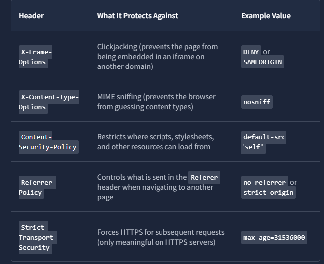
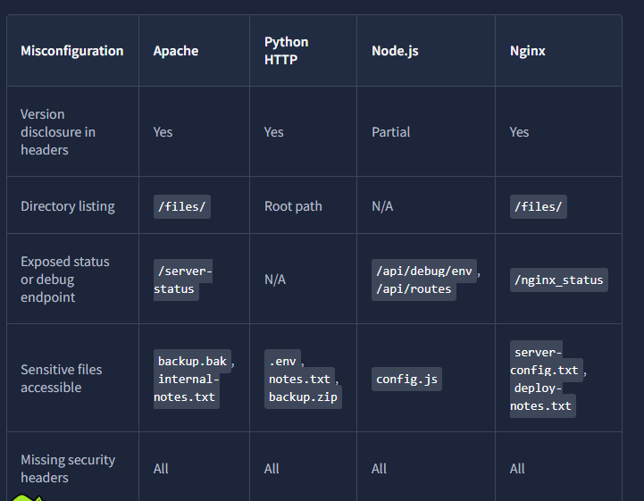

# Web server Attack I


# Python HTTP Server
- Python has built in HTTP server start with single command
    ```
    python3 -m http.server 8000
    ```
- Developers use it to quickly share files, test static websites, or transfer something between two machines on same network
- Problem "Quickly share files" sometimes becomes "accidentlly exposed to internet for six months", running on public facing servers, internal network shares, and cloud instances where someone opened port 8000 in firewall and forget about it

## What it serves?
- It serves entire working directory, including every file in it like **.env**
- There is no **.htaccess** equivalent, no blocklist, no configuration file
- If file exist in directory, anyone who can reach port 8000 can download it
- Apache or Nginx, directory listing is disabled by default but in Python's HTTP server, it has one mode: serve everything

## Directory listing
- When no **index.html** file is present in directory, Python server generates page listing every file it can see
- Browse 
    ```
    http://machine_ip:8000
    ```
- Curl using
    ```
    curl -s http://machine_ip:8000
    ```

## Accessing Dotfiles
- Dotfiles like **.env** are hidden from normal dirctory navigation on Linux, but Python's server doesn't respect that convention, it serves like other normal file
- **.env** file is common target because developers use it to store environment specific configuration, and that configuration often includes credentials
    ```
    curl -s http://machine_ip:8000/.env
    ```

## Downloading and inspecting archives
- If you see .zip, .tar.gz, or other archive in directory listing, download it and inspect the contents
- Developers sometime leave backup archives in the same directory they are serving which may contain source code, database dumps, or configuration files
    ```
    curl -s http://machine_ip:8000/backup.zip -o backup.zip
    ```
    ```
    unzip backup.zip -d backup-contents/
    ```
    ```
    cat backup-contents/db_dump.sql
    ```

## Why this matters
- Python server is realistic finding because it requires no exploitation
- The misconfiguration is that it is running in a location where it shouldn't be, serving files that shouldn't be public
- If directory shows and **index.html** file instead of showing directory listing, try requesting paths directly or navigating to subdirectories


# Apache2
- Most widely deployed web server in the world, so it nearly appears every engagement that touches web infrastructure
- It's default Ubuntu configuration leaves several things enabled that testers regularly find and report
- Three most common are
    1. Directory listing on specific paths
    2. Server-status module
    3. Backup file sitting in document root

## Version Disclosure
- Check server header
    ```
    curl -SI http://machine_ip:80 | grep -i server
    ```
    - Knowing exact version help you check for known CVEs and understand the server capabilities

## Directory Listing
- Apache's **Options +Indexes** directive tells the server to display a file listing when a directory doesn't have an **index.html** or similar default file
- Browse to
    ```
    http://machine_ip/files/
    ```
- Read every file in it, developers sometimes leave CSV exports, internal notes, or backup files in directories

## The mod_status page
- Apache has built-in status page powered by **mod_status** module
- When configured correctly, it is accessible only from localhost, when misconfigured with **Require all granted**, it is accessible from any IP
- You can access using
    ```
    http://machine_ip:80/server-status
    ```

## Finding unlinked files with Gobuster
- Backup files, old configuration copies, and forgotten test files often sit in the document root with no links pointing to them
- Tools like **Gobuster** discover these by guessing paths against a wordlist
    ```
    gobuster dir -u http://TARGET_IP:80 -w /usr/share/wordlists/SecLists/Discovery/Web-Content/common.txt -x bak,txt,html -t 20
    ```
    - If **.bak** file extension exist, it is always worth retrieving
    - Also pay attention to  **.htpasswd** files
    ```
    curl -s http://machine_ip:80/backup.bak
    ```


# Node.js(Express)
- This application behave differently from Apache and Python HTTP servers
- They are not serving static files from a configured document root
- They are running application code and that code decides what to return for every request
- Attackers look at this because developers often leave development mode features enabled when they push to production

## Framework Fingerprinting
- For **node.js** you will see **X-Powered-By: Express** in the response
    ```
    curl -sI http://machine_ip:3000
    ```
- Express sets this header automatically unless developer explicitly disables it

## Reading the Application Version
- Root path of many Express applications returns JSON status response
    ```
    curl -s http://machine_ip:3000
    ```

## Triggering verbose Errors
- Express built-in error handler suppresses stack traces when **NODE_ENV** is set to **Production**
- In **development** mode, it passes them through
- But developers often write their own error handlers, and those custom handlers expose stack traces regardless of **NODE_ENV**
- **NODE_ENV=production** is meaningful if no custom error handler overrides it
- API call to Express server
    ```
    curl -s http://machine_ip:3000/api/users | python3 -m json.tool


## Enumerating routes via Debug endpoints
- Misconfigured express application tell you all of its own routes     
- Developer sometimes build a debug endpoint that lists every registered route for convenience during development, then forget to remove it before going live
    ```
    curl -s http://machine_ip:3000/api/routes
    ```

## Exposed environment variables
- Environment variables in Node.js applications often contain database credentials, API keys, and configuration flags
- Debug endpoint that returns **process.env** is a significant finding
    ```
    curl -s http://machine_ip:3000/api/debug/env
    ```

## Static file serving
- Express use **express.static()** middleware to serve front-end assets like JavaScript, stylesheets, and configuration
- Client side JavaScript file sometimes contain API endpoint, URLs, internal hostnames, or debug flags
    ```
    curl -s http://machine_ip:3000/static/config.js
    ```           


# Nginx
- After Apache and Node.js, the Nginx investigation follows the same template but with its own configuration vocabulary
- It is most commonly used as reverse proxy, a load balancer, or a high performance static file server.
- In production environment, it sits in front of an application server and handles the public facing traffic. So, misconfigured Nginx can expose internal structure, reveal operational data, or make files accessible that should not be.
- Nginx typically run on port 80 or 443

## Version Disclosure
    ```
    curl -sI http://machine_ip:80 | grep -i server
    ```
- It uses **server_tokens** directive to controls both Server header and the version string in default error pages
- Setting **server_tokens** off suppresses the version from both places at once
- If Server header is suppressed, requesting non-existent path will confirm whether **server_tokens** is truly off or just partially configured
    ```
    curl -s http://machine_ip:80/nonexistent-path
    ```

## Directory listing with Autoindex
- Nginx doesn't enable directory listing by default
- When developer want to expose they add **autoindex** to location block in configuration
```
location /files/ {
    autoindex on;
    root /var/www/nginx/;
}
```
- Browse to file directory
    ```
    http://machine_ip/files/
    ```
- or curl
    ```
    curl -s http://machine_ip/files/
    ```

## The nginx_status Endpoint
- **stub_staus** module exposes real-time connection metrics at a configurable URL
- The secure configuration restricts access to localhost only
- Misconfigured version allows acccess from any IP
```
location /nginx_status{
    stub_status;
    allow all; # should be: allow 127.0.0.1; deny all;
}
```
- Request to see what it exposes
    ```
    curl -s http://machine_ip:80/nginx_status
    ```

- Nginx configuration files live in **/etc/nginx/**
- If you ever have shell access to machine running Nginx, read site configuration in **/etc/nginx/sites-available/**


# Common Misconfigurations Across Servers
- We see four servers with its own configuration model and its own set of common mistakes
- There are also patterns that appear regardless of what server is running
- Two most consistent are
    1. Security headers
    2. Finding with automated scanning

## Security Headers
- It is HTTP response headers that instruct the browser on how to handle the page content
- They protect against a range of client-side attacks including clickjacking, MIME sniffing, and cross site scripting

- **X-Frame_Options** is tenchincally superseded by **Content-Security-Policy: frame-ancestors**, which provides finer grained control
- Modern sites may handle clickjacking protection through CSP alone and intentionally omit **X-Frame-Options**
    ```
    for port in 80 8000 3000 8080; do echo "=== Port $port ==="; curl -sI http://10.48.171.88:$port/ | grep -iE "x-frame-options|x-content-type|content-security-policy|strict-transport|referrer-policy" || echo "(no security headers found)"; done
    ```
    - When **grep** returns no output, it means none of those headers is present
    - **Strict-Transport-Security** only applies over HTTPS connection

## Automated scanning with Nikto
- Nikto is web server scanner that checks for known misconfigurations, outdated software, exposed admin interfaces, and missing security headers
    ```
    nikto -h http://machine_ip:80 -nointeractive
    ```
    - **-nointeractive** flag suppresses prompts so the scan runs without waiting for input


