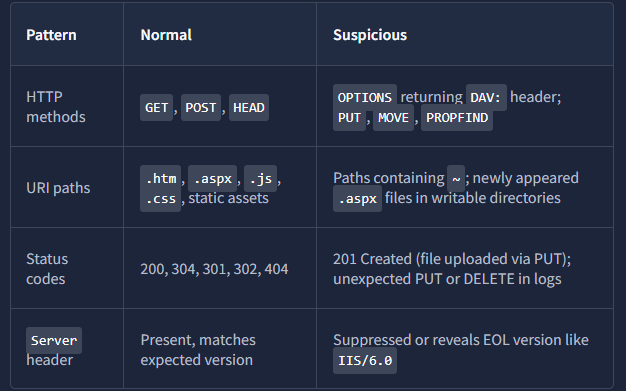

# Introduction
- IIS is installed on virtually every Windows Server running a web application, intranet portal, or REST API
- IIS is tightly integrated with Windows authentication, active directory, and the .NET runtime, which makes it a high value initial access target
- **Lazarus Group** exploited IIS servers in 2023 to gain initial access and distribute malware
- HAFNIUM deployed ASPX web shells on IIS during Exchange ProxyLogon campaign in 2021

# IIS Fingerprinting and Enumeration
- IIS version tells you which CVEs apply


## HTTP Banner Grabbing
- The fastest way to fingerprint IIS is to read the response headers
- IIS includes Server header in every response
    ```
    curl -I http://machine_ip
    ```

## WebDAV detection with Options
- Web Distributed Authoring and Versioning(WebDAV) is an HTTP extension that adds file management verbs: **PUT(upload), DELETE, COPY, MOVE, PROPFIND, and LOCK**
- HTTP **OPTIONS** method ask server to return its supported methods
    ``` 
    curl -X OPTIONS http://mchine_ip -sv 2>&1 | grep -E "Allow:|DAV"
    ```
    - If **Allow** list only contains **GET, HEAD, POST, and OPTIONS** means WebDAV is off
    - When you see **PUT, MOVE, and DAV 1,2**, WebDAV is enabled and you should test it for write access

## Testing what file types can be uploaded and executed         
- Knowing WebDAV is not enough, you need to know whether you can upload files and, critically, whether uploaded files are executed
- Approach is straightforward: **PUT** a test file, then **GET** it and observe the response
- **200** with output means server executed it, **200** with you raw file content means it was served statically
    ```
    curl -s -o /dev/null -w "PUT aspx: %{http_code}\n" -X PUT --data '<%@ Page Language=Jscript%><%Response.Write(1+1)%>' http://10.49.157.103/webdav/test.aspx
    ```


